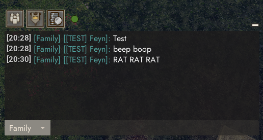

# ChatPlus

Small improvements to the in-game chat of **Anvil Empires**.

**[Download ChatPlus.zip](../../../releases/latest/download/ChatPlus.zip)**
· [How to install](../README.md#installation)
· Author: [Feyn](https://github.com/HarvFeyn)

Version 0.1.0, tested with the Anvil Empires playtest of November 2026 and
`UE4SS_v3.0.1-1181-g83330635`.



## What it does

Shows the time of each chat message in front of it, in grey:

```
[22:41] [Family] [[ART] Feyn]: hello
```

The time is your own computer's clock, so it is in your time zone.

### Channel lock

The channel you pick in the chat (Empire, Family, Local) stays picked.
The game puts it back on Empire when you change area (entering or leaving
a cave) or avatar; the mod picks your channel again, so a message meant
for your family does not reach the whole faction.

The lock lasts until you close the game: at the next start, the chat
begins on the game's default channel as usual.

## Good to know

- The game does not send the time of a message, so the mod shows the time
  the message reached your game. For messages in the chat while you play,
  that is the same.
- Messages already in the chat when you join get no time: it is not known.

## What it does not do

It only changes what your own screen shows, and picks again in the chat's
menu the channel you chose, as you would by hand. Your messages are not
changed.
