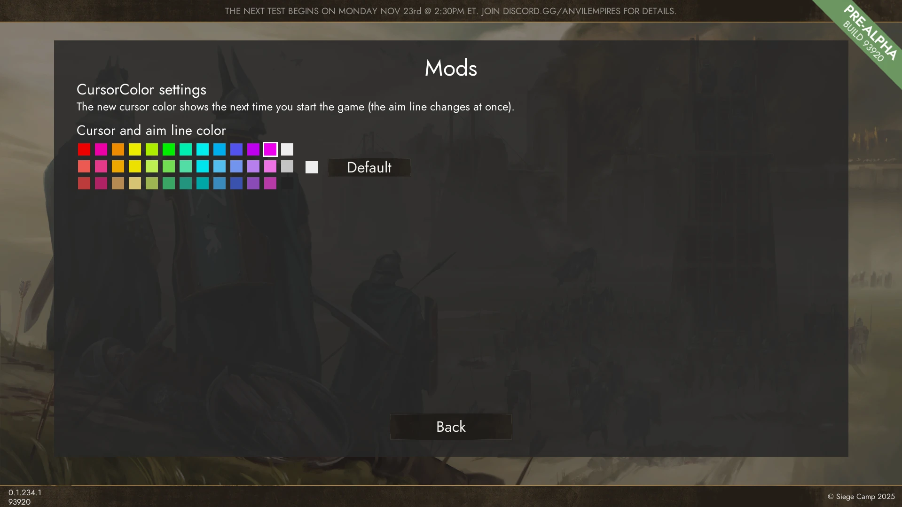

# CursorColor

Colours the mouse cursor of **Anvil Empires**, and the bow's aim line, so
they are easier to see.

**[Download CursorColor.zip](../../../releases/latest/download/CursorColor.zip)**
· [How to install](../README.md#installation)
· Author: [Feyn](https://github.com/HarvFeyn)

Version 0.1.0, tested with the Anvil Empires playtest of November 2026 and
`UE4SS_v3.0.1-1181-g83330635`.

## What it does

- The cursor takes the colour you choose: the arrow, and the sword,
  hammer and aiming cursors the game switches to on its own. Only the
  light parts take the colour; the dark outline stays dark.
- The bow's aim line takes the same colour. The part of the line past an
  obstacle keeps the game's orange, so you still see when something is in
  the way.

By default the mod changes nothing: pick a colour in its settings.

## Choose the colour

In the main menu, click **Mods**, then **Settings** next to CursorColor,
and pick a colour. **Default** goes back to the game's own cursor and aim
line (the cursor at the next start).

- **The cursor changes at the next start of the game.** The game loads
  its cursor images when it starts, so restart it after a change.
- The aim line changes at once.
- The game makes the aim line lighter, so pick a bright, saturated colour.
  Avoid red, orange and pink: the line turns orange past an obstacle, and
  those colours look too close to it.

## How it works

The game draws its cursors from image files packed with the game. The mod
reads those images from the game's files, tints them, and writes a small
file of its own next to the game's: `Anvil\Content\Paks\zCursorColor_P.pak`.
The game then uses those images instead of its own. The mod only adds that
file: no file of the game is changed.

## Uninstall

- Turning the mod off in the **Mods** menu removes `zCursorColor_P.pak`:
  the game's own cursors are back at the next start.
- If you delete the mod's folder by hand instead, also delete
  `Anvil\Content\Paks\zCursorColor_P.pak`, or the cursors stay coloured.

## What it does not do

It only changes what your own screen shows. Nothing is sent to the server,
and the cursor and aim line work exactly as before.
