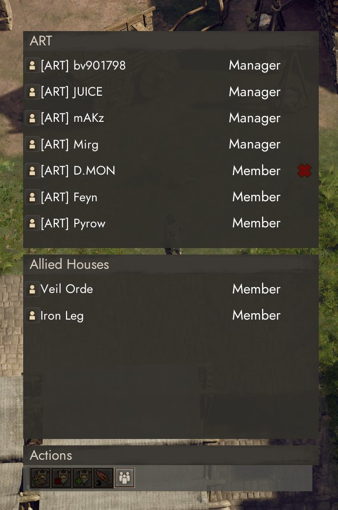

# HouseScreenSorter

Sorts the family house member list of **Anvil Empires** by role and
name, and adds an online-only filter button.

**[Download HouseScreenSorter.zip](../../../releases/latest/download/HouseScreenSorter.zip)**
· [How to install](../README.md#installation)
· Author: [@gabrdeux](https://github.com/gabrdeux)

Version 0.1.0, tested with the Anvil Empires playtest of November 2026 and
`UE4SS_v3.0.1-1181-g83330635`.

## What it does

When opening the Family/House window (`F2`):

- **Deterministic Sort**: Automatically groups and sorts members:
  1. **Founder**
  2. **Managers** (alphabetically A-Z)
  3. **Members** (alphabetically A-Z)
  4. **Guests** (alphabetically A-Z)
  5. **Public / Other** (alphabetically A-Z)
- **Online-Only Filter Button**: Adds a toggle button next to the House action
  strip. Clicking it toggles between displaying all members and showing only
  members currently online or deployed. Offline rows are collapsed without
  leaving blank gaps.
- Native promotions, demotions, role dropdowns, and kick actions continue to
  work as in the unmodded game.

## What it does not do

It only rearranges and toggles visibility of the member widgets on your screen.
It never changes player roles on the server, alters permissions, or sends
unauthorized network traffic.

## Known limitations

- The game's native tick populates member data when the window first opens;
  the mod waits for member names to resolve before locking the sorted order,
  which may take a brief fraction of a second.
